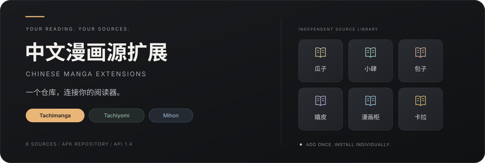

<p align="center">
  
</p>

<p align="center">
  <strong>六个漫画站，一次添加，按需安装。</strong><br>
  <sub>独立漫画源 APK · 固定仓库地址 · 客户端内安装与更新</sub>
</p>

<p align="center">
  <a href="#install">添加仓库</a> &nbsp;·&nbsp;
  <a href="#sources">漫画源与下载</a> &nbsp;·&nbsp;
  <a href="#compatibility">客户端兼容</a> &nbsp;·&nbsp;
  <a href="https://github.com/dddinmx/MangaDock-extensions/issues">问题反馈</a>
</p>

# 中文漫画源扩展仓库

面向 **Tachimanga、Tachiyomi 和兼容版本 Mihon** 的中文漫画源扩展仓库，集中提供瓜子漫画、包子漫画.org、漫画柜、嬉皮漫画、漫小肆和卡拉漫画的独立 APK。添加一个扩展仓库地址，即可在阅读器中按需安装漫画插件、获取更新，方便测试漫画搜索、作品简介、章节列表和阅读功能。

A **Chinese manga / manhua source repository** for **Tachimanga, Tachiyomi and compatible Mihon versions**. Install and update independent **APK extensions** from a single repository URL.

<a id="install"></a>

## 添加一次，以后在客户端更新

**复制仓库地址：**

```text
https://raw.githubusercontent.com/dddinmx/MangaDock-extensions/main/index.min.json
```

1. 在 Tachimanga 中进入「浏览 → 扩展 → 扩展仓库」，添加上面的地址。不同客户端版本的入口名称可能略有不同。
2. 刷新扩展列表，选择要使用的漫画源并安装。
3. 后续仓库发布新版后，在客户端刷新并更新对应扩展即可。

使用 Tachiyomi / Mihon 时，请先查看下方兼容范围；支持扩展仓库的版本可添加同一地址，也可使用漫画源卡片中的 APK 下载链接。

<p>
  <a href="https://raw.githubusercontent.com/dddinmx/MangaDock-extensions/main/index.min.json">打开安装索引 ↗</a>
  &nbsp;·&nbsp;
  <a href="index.json">查看版本清单 ↗</a>
</p>

<a id="sources"></a>

## 六个独立漫画源

每个 APK 对应一个站点，可分别安装、更新和测试。

<!-- sources:start -->
<table>
  <tr>
    <td align="center" width="33%">
      <br><br><br>
      <strong>瓜子漫画</strong><br>
      <sub>Guazimanhua</sub><br><br>
      <a href="https://raw.githubusercontent.com/dddinmx/MangaDock-extensions/main/apk/tachiyomi-zh.mangadockguazimanhua-v1.4.1.apk">下载 APK · 1.4.1</a><br><br>
    </td>
    <td align="center" width="33%">
      <br><br><br>
      <strong>包子漫画.org</strong><br>
      <sub>Baozimh.org</sub><br><br>
      <a href="https://raw.githubusercontent.com/dddinmx/MangaDock-extensions/main/apk/tachiyomi-zh.mangadockbaozimhorg-v1.4.1.apk">下载 APK · 1.4.1</a><br><br>
    </td>
    <td align="center" width="33%">
      <br><br><br>
      <strong>漫画柜</strong><br>
      <sub>Manhuagui</sub><br><br>
      <a href="https://raw.githubusercontent.com/dddinmx/MangaDock-extensions/main/apk/tachiyomi-zh.mangadockmanhuagui-v1.4.1.apk">下载 APK · 1.4.1</a><br><br>
    </td>
  </tr>
  <tr>
    <td align="center" width="33%">
      <br><br><br>
      <strong>嬉皮漫画</strong><br>
      <sub>Hipmh</sub><br><br>
      <a href="https://raw.githubusercontent.com/dddinmx/MangaDock-extensions/main/apk/tachiyomi-zh.mangadockhipmh-v1.4.4.apk">下载 APK · 1.4.4</a><br><br>
    </td>
    <td align="center" width="33%">
      <br><br><br>
      <strong>漫小肆</strong><br>
      <sub>Manxiaosi · MXS</sub><br><br>
      <a href="https://raw.githubusercontent.com/dddinmx/MangaDock-extensions/main/apk/tachiyomi-zh.mangadockmxs-v1.4.1.apk">下载 APK · 1.4.1</a><br><br>
    </td>
    <td align="center" width="33%">
      <br><br><br>
      <strong>卡拉漫画</strong><br>
      <sub>Kalamanhua</sub><br><br>
      <a href="https://raw.githubusercontent.com/dddinmx/MangaDock-extensions/main/apk/tachiyomi-zh.mangadockkalamanhua-v1.4.1.apk">下载 APK · 1.4.1</a><br><br>
    </td>
  </tr>
</table>
<!-- sources:end -->

包子漫画扩展对应 **baozimh.org**；嬉皮漫画也称 **嬉皮漫畫 / Hipmh**，漫画柜对应 **Manhuagui**，漫小肆对应 **MXS**。各扩展直接访问对应漫画源站。

<a id="compatibility"></a>

## 客户端兼容

| 阅读器 | 当前发布包的适用范围 |
| :--- | :--- |
| **Tachimanga** | 当前主要测试客户端，提供 API 1.4 扩展 APK。 |
| **Tachiyomi** | 适用于仍支持 1.4 扩展规范的版本。 |
| **Mihon** | 适用于仍兼容 1.4 扩展的版本；要求 TachiyomiX 1.6 的版本不能使用当前 APK。 |

当前仓库只分发 **1.4 测试版**。将 Mihon 列在这里是为了说明兼容范围，不代表已经完成新版 1.6 适配。

## 测试进展

| 检查项目 | 当前状态 |
| :--- | :--- |
| APK 发布检查 | 已核对签名、包名、实际版本、下载链接及 SHA-256。 |
| 嬉皮漫画 | 已进行真实接口和解析回归测试，Tachimanga 实机表现仍在反馈与修复中。 |
| 卡拉漫画 | 源站实测返回 HTTP 403，目前只通过解析约定测试。 |
| 其他漫画源 | 已发布独立测试包，仍需逐站验证手机端安装和阅读。 |

查看 [构建检查记录](verification.json) 或 [SHA-256 校验清单](SHA256SUMS)。

<details>
<summary><strong>已经手动安装过旧 APK，怎么更新？</strong></summary>

添加仓库后，先刷新扩展列表并更新。包名、签名和源 ID 延续已有版本。

如果安装界面仍显示旧版本，请在扩展页移除旧扩展后重新安装，再核对已安装版本与上方卡片是否一致。书架作品保留即可。

</details>

<details>
<summary><strong>加载慢、章节空白或图片打不开，如何反馈？</strong></summary>

请在 [Issues](https://github.com/dddinmx/MangaDock-extensions/issues/new) 提供：阅读器名称与版本、漫画源和扩展版本、漫画名称或链接，以及卡在哪一步（搜索、简介、章节或图片）。有错误提示时，请一并附上。

站点可访问情况会随网络、地区和源站变化。发布 APK 不等于所有站点均已在手机端验证可读。

</details>

---

<p align="center">
  <sub>独立安装 · 按源更新 · 持续测试</sub><br>
  <sub><a href="https://tachimanga.app/help/guides/repositories.html">Tachimanga 仓库文档</a> · <a href="https://github.com/dddinmx/MangaDock-extensions/issues">反馈问题</a></sub>
</p>
